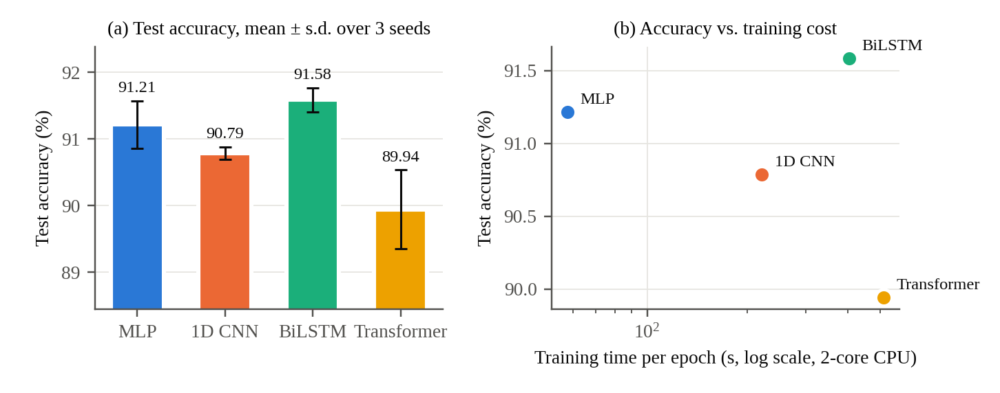
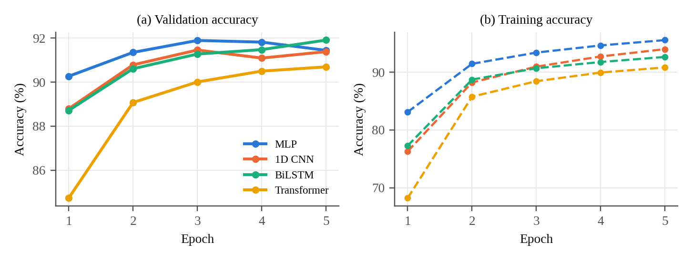
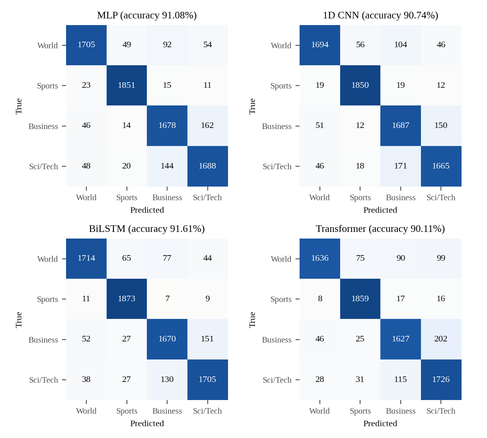
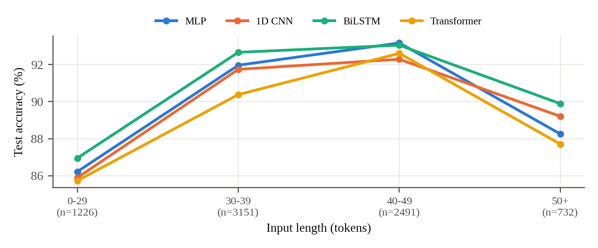

# Comparative Analysis of Deep Learning Architectures for AG News Topic Classification

ICT 4442 Deep Learning Mini Project — School of Computer Engineering, MIT Manipal.

Four architecture families — MLP, 1D CNN, BiLSTM and Transformer encoder — are trained from scratch on the
AG News 4-class topic classification benchmark (World, Sports, Business, Sci/Tech) with one preprocessing
pipeline, one data split, one training protocol and an equal tuning budget.

## Final results

Test set: the official 7,600 AG News test samples. Mean ± standard deviation over 3 seeds (42, 13, 7)
of the configuration selected on validation accuracy. Times measured on a 2-core CPU, one thread per run, two runs sharing the machine.

| Model | Owner | Test accuracy (%) | Macro F1 | Params | s / epoch |
|---|---|---|---|---|---|
| MLP | Siya Srivastava | 91.21 ± 0.36 | 0.9121 ± 0.0035 | 7.81 M | 58 |
| 1D CNN | Urvi Kedar Mapsenkar | 90.79 ± 0.10 | 0.9077 ± 0.0007 | 4.15 M | 221 |
| BiLSTM | Nehal Rai | 91.58 ± 0.18 | 0.9155 ± 0.0018 | 4.11 M | 404 |
| Transformer encoder | Aanyaa Agarwwal | 89.94 ± 0.59 | 0.8990 ± 0.0063 | 4.11 M | 512 |






## Team

| Member | Reg. No. | Model | Other responsibilities |
|---|---|---|---|
| Siya Srivastava | 230911090 | Model 1 — MLP | Text cleaning, preprocessing pipeline, input-length analysis |
| Urvi Kedar Mapsenkar | 230911538 | Model 2 — 1D CNN | Vocabulary and encoding, significance tests |
| Nehal Rai | 230911082 | Model 3 — BiLSTM | Training script, experiment driver, error analysis |
| Aanyaa Agarwwal | 230953040 | Model 4 — Transformer encoder | Model comparison, figures, documentation |

## Repository layout

```
configs/tuning.json         tuning plan: 3 configurations per model, final seeds
scripts/download_data.py    download the AG News CSV files into data/
src/text_utils.py           loading, cleaning, tokenisation
src/vocab.py                vocabulary (train split only), encoding, split statistics
src/preprocess.py           full pipeline -> processed/*.npz, vocab.json, stats.json
src/models/                 mlp.py, cnn.py, bilstm.py, transformer.py (one file per member)
src/train.py                common training/evaluation protocol (early stopping, clipping, seeds)
src/run_experiments.py      tuning -> selection on validation -> final 3-seed runs
src/compare_models.py       final comparison table (mean ± s.d.)
src/error_analysis.py       confusion pairs, shared errors across models
src/significance.py         pairwise McNemar tests
src/length_analysis.py      accuracy by input length
src/make_figures.py         report figures
results/tuning/             validation results of every tuning run
results/final/              final runs, comparison, error/significance/length analyses
results/*.json, *.log       interim (Phase 2) preliminary runs of MLP and CNN
figures/                    figures used in the report
```

## How to reproduce

```bash
pip install -r requirements.txt
python scripts/download_data.py
python src/preprocess.py
python src/run_experiments.py        # all tuning + final runs (several hours on CPU; use a GPU/Colab if available)
python src/compare_models.py
python src/error_analysis.py
python src/significance.py
python src/length_analysis.py
python src/make_figures.py
```

A single run: `python src/train.py --model bilstm --hp '{"hidden": 128}' --seed 42`.
All commands are run from the repository root.

## Protocol

- **Data:** AG News (Zhang et al., 2015): 120,000 training and 7,600 test samples, 4 balanced classes.
- **Preprocessing:** title + description; HTML entities, URLs and punctuation removed; lower-cased; regex tokenisation;
  30,000-word vocabulary from the training split only; sequences padded/truncated to 64 tokens.
- **Split:** official training set split 90/10 (stratified, seed 42) into 108,000 train / 12,000 validation.
- **Training:** Adam, batch 128, cross-entropy, gradient clipping 1.0, at most 5 epochs with early stopping
  (patience 2) on validation accuracy; embeddings trained from scratch.
- **Tuning:** 3 configurations per model, selected on validation accuracy only; test set used once per final run.
- **Metrics:** accuracy, macro precision/recall/F1, per-class F1, confusion matrix, McNemar tests, time per epoch.

## External code and AI tools

Libraries: PyTorch, scikit-learn, SciPy, pandas, NumPy, Matplotlib. The dataset is the public AG News CSV release.
See the project report for the team's declaration on AI-tool use.
